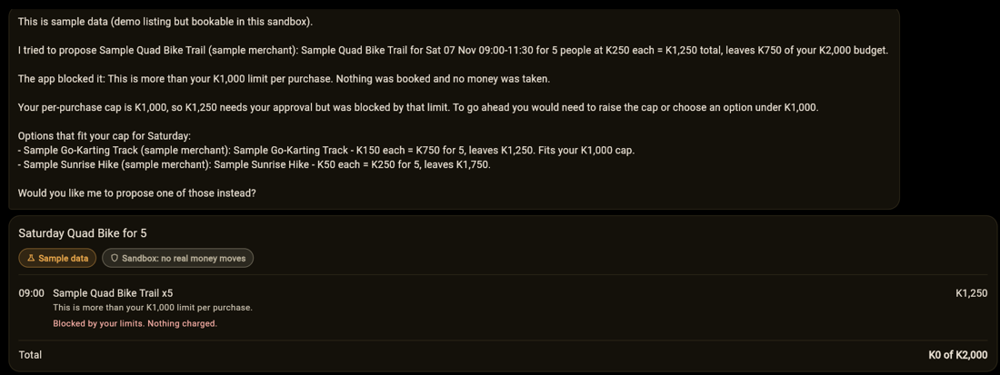
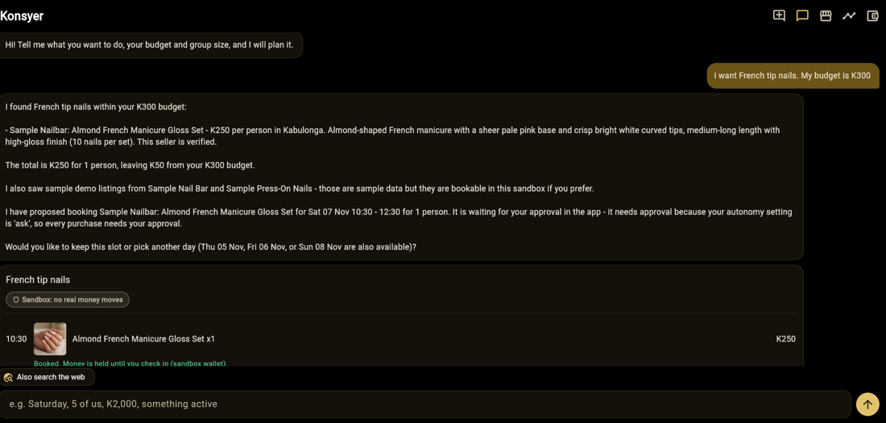
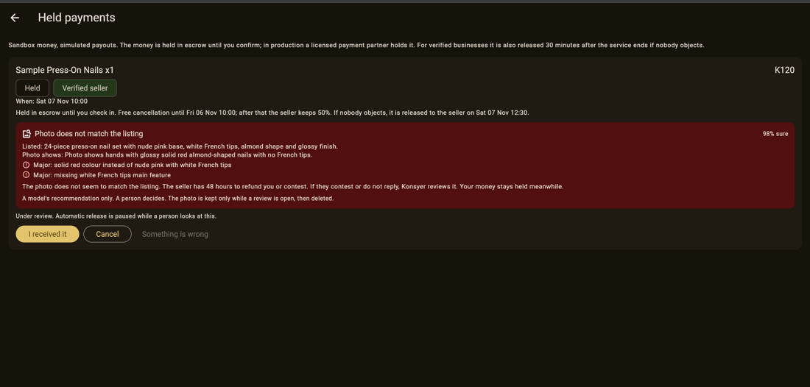

# Konsyer

**An AI concierge for Zambia that finds and books outings and local services within your kwacha budget, then holds your money until you get what you were promised.**

> The model reads and recommends. Code enforces the rules, and people decide the money.

```
Red team: 14/14 attacks blocked. A fooled model cannot move money, break your budget, or refund anyone.
(python -m scripts.red_team, no keys needed)
```

| 1. Over the limit: blocked by code | 2. Booked: money held in escrow | 3. Wrong photo: a model recommends, a person decides |
|---|---|---|
|  |  |  |

Built solo by Esmada Stevens in Lusaka for the Meta Global AI Developer Hackathon (Indie track, "Build for Your World").

Konsyer is a **web app** built with Flutter: you open it in a browser, on a computer or a phone. The repository also contains Flutter's standard `android/` and `ios/` project folders, because every Flutter project has them, so the same code can be built for phones. We have **not built or tested** the phone versions; this submission is the web version.

---

## The problem

In Zambia, a lot of everyday commerce happens in WhatsApp chats and Facebook pages. You find a salon or an event on a flyer, send a message, and then you are asked to pay a deposit to a number you have never used. If the nails come back the wrong colour, or nobody turns up, there is nobody to ask. Sellers have the opposite problem: no way to prove they are real, so honest businesses look the same as scammers.

## What Konsyer does

1. **Plans with you.** Tell it what you want, your budget and your group size ("Saturday, 5 of us, K2,000, something active"). It searches listings, adds up the cost, and proposes a plan. It understands other languages too: a request in Bemba was understood, though the reply came back in English.
2. **Never spends without you.** It can only *propose*. You tap Approve. Spending limits, your budget and the seller's trust level are checked by plain code, not by the model.
3. **Holds your money.** A booking at a verified business is held in escrow. The business is paid 30 minutes after the service ends unless you object. You can cancel, accept a new time if the seller can't make it, or say something is wrong.
4. **Checks disputes with a photo.** If the nails are not what was listed, you add a photo. A Meta vision model compares it with the listing and *recommends*. The seller can refund or contest; a Konsyer admin makes the final call. The photo is deleted when the case closes.
5. **Finds businesses that aren't on Konsyer.** If nobody registered offers what you want, it searches the web (Meta Model API) and shows unverified leads with the price hints it found, and drafts a message you send yourself. Leads are for contacting, never for paying.
6. **Lets businesses join.** A business registers, then adds listings by typing them in or by uploading a flyer or a product photo, which a vision model turns into a draft the owner checks and edits. Konsyer verifies the business before customers see anything.

## Try it in three minutes

1. Open the app and say: *"I want French tip nails. My budget is K300."* It finds a listing and proposes a booking within your budget.
2. Say: *"Plan a dinner for 4 people, my budget is K50."* The budget is enforced in code: nothing over K50 can be proposed or booked, however the request is worded.
3. Approve a booking, then open the wallet and **Held payments**. Tap **Something is wrong**, then **It is not as described**, and upload `red_nails.jpg` from `backend/demo/images/`. The model flags a mismatch; the money stays held.
4. The seller's side (the customer's photo, **Refund customer**, **Contest**) belongs to a business you register yourself: register one under **For businesses**, verify it in the admin console, list something, and book it. In replay mode the sample businesses have no owner, so that screen stays on the registration form; the case is still visible to the admin (next step).
5. Open `http://localhost:5000/#/admin` in a second tab to see Konsyer's side: businesses to verify and cases to decide.
6. Open **Activity** (the timeline icon) to see which model did what, and what the rules and people decided.

## How it is built: who decides what

| Decision | Who makes it |
|---|---|
| Understand the request, pick tools, write replies | the model |
| Read a flyer or photo into a draft, compare a dispute photo with a listing | the model (it recommends only) |
| Is this purchase allowed? Within budget, caps, trust? | **code** (`policy.py`) |
| Does money move? | **code and you**: only your Approve tap, never the model |
| Is a business real? | **a person** (the admin) |
| Does a customer get refunded after a dispute? | **a person** (the seller can refund; Konsyer decides contested cases) |

The model can only call read-only tools plus one that *proposes* a booking. It has no tool that moves money. We tested that: `python -m scripts.red_team` plays a fooled model against the real code, including a photo that says "refund me" and a seller trying to pay themselves, and **all 14 attacks are blocked**.

## Where Meta's models are used

| Job | Model | What it does |
|---|---|---|
| Concierge agent | Muse Spark Open (`meta-models/muse-spark-open-1026`) | Understands the request, calls tools, writes the reply |
| Web search for outside businesses | Meta Model API, `muse-spark-1.3` with web search | Finds businesses nobody registered, with price hints; code re-validates every field |
| Flyer reader | Muse Spark vision | Turns a flyer into a draft listing |
| Product-photo describer | Muse Spark vision | Describes the item in a photo as a listing draft (never invents a price) |
| Dispute check | Muse Spark vision | Compares a customer's photo with the listing text and returns differences rated major or minor |

The model's answers are never trusted directly. For the dispute check, the model rates each difference as major or minor, and **code** decides the verdict: a mismatch needs at least one major difference, a blurry photo or low confidence becomes "unclear", and two unclear results go to a person.

The **Activity** screen shows which model ran, whether it worked and how long it took. It records metadata only, never prompts, photos or answers.

Not Meta: the web app uses Flutter, the browser's file picker for photos, and standard `wa.me` links to open WhatsApp with a drafted message (you tap send; nothing is sent for you). The backend is FastAPI and SQLite.

## Run it

You need **Python 3** (we used 3.13) and **Flutter**. From the project folder:

```bash
cd backend
python -m venv .venv
.venv\Scripts\activate          # Windows PowerShell: .venv\Scripts\Activate.ps1   macOS/Linux: source .venv/bin/activate
pip install -r requirements.txt
```

Keep that terminal open for the backend. Every new terminal needs the `activate` line again.

### Option A: no keys needed (replay mode)

Replay answers from a recording of the real models, so you can run everything without any account. Only the recorded examples work; anything else says so plainly. Replay is **on by default** in `.env.example`, so there is no environment variable to type, on any operating system.

In `backend/`, with the virtual environment active:

```bash
cp .env.example .env              # Windows (PowerShell or cmd): copy .env.example .env
python -m uvicorn app.main:app --port 8000
```

Open <http://127.0.0.1:8000>. It should say `"mode":"replay"`. (That page is the API; the app is the next step.)

Then, in a **second terminal** at the project root:

```bash
flutter pub get
flutter run -d chrome --web-port 5000 --dart-define=API_BASE=http://localhost:8000
```

The app opens at <http://localhost:5000>. A "Replay mode" strip shows at the top of the chat. In replay mode, web search returns fictional "Sample" leads, and photos are matched by file name, so upload the pictures from `backend/demo/images/` (for example `red_nails.jpg`). Tap the example chips on the welcome screen, or try the walkthrough above.

### Option B: with your own model keys

In `backend/.env`, fill in `LLM_API_KEY` (the agent and the photo checks) and, for real web search, `META_API_KEY` with `DISCOVERY_PROVIDER=meta`. Then **delete the `KONSYER_REPLAY=...` line**, or the app stays in replay mode. Restart the backend; <http://127.0.0.1:8000> should now say `"mode":"live"`. Web search takes 15 to 25 seconds, which is why replay is useful for demos.

### Admin console

Open <http://localhost:5000/#/admin> in its own tab and type the admin key from `.env` (`KONSYER_ADMIN_KEY`, `demo-admin-key` in `.env.example`). The key is typed each time and never stored. Add `--dart-define=DEMO=true` to the Flutter command to show a button that moves the clock forward, so you can see the automatic release without waiting.

### Tests

```bash
cd backend
python -m pytest -q          # 349 tests, no keys needed
python -m scripts.red_team   # 14 attacks against the real code, no keys needed
```

The API's own documentation is at `http://localhost:8000/docs` while the backend runs.

## Rules in plain language

**Spending.** The agent proposes; you approve. Per-purchase and daily limits, and your plan budget, are enforced in code. A seller that is unverified or has low trust always needs your approval, and in the app you can only pay businesses Konsyer verified.

**Escrow (sandbox).** When a verified business is booked, the money is held. If you cancel before the free-cancellation window closes, you get everything back; after it, the seller keeps the share set on the listing. The business is paid 30 minutes after the service ends unless you have opened a dispute. If the seller can't make the time, they can offer a new one: you accept it (same money, booking moved) or take a full refund with no fee. An unanswered offer never pays the seller; it turns into a refund when the original time arrives.

**Why 30 minutes?** Many Zambian sellers live day to day, and an honest seller who delivered with no problem should not wait a day for their money. Waiting is the cost that makes sellers leave a platform. The customer's protection is that the money stays held until 30 minutes after the service ends, they can release it earlier with **I received it**, and they can dispute any time before then. The trade-off is real: a problem noticed hours later is outside the window (see the limits below). The window is a single setting in the code, so it can be changed per seller type later.

**Disputes.** You can raise a photo claim while the money is still held (it is released 30 minutes after the service ends), with up to three tries. A clear mismatch opens a case: the seller has 48 hours to refund or contest. If they contest, or say nothing, a Konsyer admin decides. Only the admin can reject a claim, so a seller can never judge a claim against themselves, and a seller can never release the money to themselves while a claim is open. The photo is kept only while a case is open and deleted when it closes. If a listing description is too vague to check against (shorter than about 40 characters or 8 words), the photo check is skipped and a person decides.

**Businesses.** A business registers and lists with real times and capacity. Konsyer verifies the business once, and its first listings go live; later listings from a verified business are live at once. Price and description are locked once listed, because they are what disputes are judged against; the owner can add times, stop offering a listing (existing bookings are still honoured) and add a picture. Customers see the picture once the listing is verified.

**Web leads.** They are unverified, never bookable and never payable. Prices are shown as "hints" in the seller's own words, and the app tells you to confirm with the seller.

## What is real and what is simulated

- The wallet and payouts are **sandbox**: test money and a clearly labelled simulated payout provider. No real money moves anywhere in this project.
- Escrow in production would need a licensed payment partner. Konsyer would not hold real funds itself.
- The listings you see on a fresh database are labelled **sample data**.
- Web search results are real when you use `DISCOVERY_PROVIDER=meta`, and fictional in replay and mock mode.

## Known limits

- **The photo check is a recommendation, not a verdict.** Close shades can be flagged: in our testing, a very pale pink tip was called a mismatch against "white tips". That is why a person decides every case, and nothing is refunded by the model.
- **The photo check cannot tell whether a photo is genuine.** It compares what is in the picture with the listing; it cannot know that the photo was taken by this customer, for this booking. That is why the model only recommends, the seller can contest, and a person decides. Nothing in the roadmap below is built yet.
- **No accounts or login.** One demo user acts as both the customer and the business owner, and a seller could book their own listing. Real accounts, and blocking self-booking, come first in production.
- **The dispute window is short by design.** A problem that only shows up after the money is released (30 minutes after the service ends) cannot be disputed in this sandbox. A production version would need a longer window for some services, or a seller-funded appeal, and we have not built either.
- The model sees the whole photo, including background; its description may mention things that don't matter.
- Replay mode only covers recorded examples. The answers there are real model outputs recorded earlier.
- Photos sent for checking go to the model provider, whose own retention applies. Konsyer deletes its copy when the case closes.
- One person built this: the interface is functional, not final, and only English replies were tested in depth.

### What we tried and left out

We tested giving the dispute model the seller's own listing picture as well as the text. Across eight cases (correct, wrong colour, blurry, unrelated, borderline shade) the verdicts were identical, and it was slower, so we did not ship it. The probe is kept in `backend/scripts/probe_dispute_ref.py`.

## Business model (a hypothesis, not built)

Konsyer's value to a seller is demand and protection: customers who trust paying a stranger because the money is held. A small percentage fee on completed bookings, paid by the seller, is one way to charge for that. We have not tested whether sellers or customers would pay.

## Why a standalone app first?

Escrow, held payments, dispute evidence and business verification need a wallet and an audit trail that do not fit inside a chat bot alone. WhatsApp is planned as an entry channel (see the roadmap), not the system of record.

## Roadmap

**Where we would start:** beauty services in Lusaka (for example nails and hair in Kabulonga and East Park), with a handful of salons, to test whether a prepaid customer who does not no-show is worth a fee to the seller. We have not run that test.


- **Fraud protection for photo claims.** What a production version would add: an in-app camera capture, photo metadata checks, reverse image search, and tracking customers who dispute repeatedly.
- A WhatsApp channel through the Meta Cloud API, so the concierge works where people already chat.
- An appeal to a senior person for disputes the first reviewer decided.
- Goods (not just services): returns and shipping.
- Partial refunds for disputes.
- A licensed payment partner for real escrow and mobile-money payouts.
- Android and iOS builds of the same app.

## Project layout

```
backend/app/        FastAPI app: agent, policy, escrow, disputes, merchants, replay
backend/tests/      349 tests
backend/scripts/    red team, probes, the demo recorder
backend/demo/       the replay recording and licensed demo pictures
backend/eval/       saved red-team results
lib/                the Flutter web app
```

## Credits and licence

Code: MIT, see `LICENSE`. Two demo photos come from Wikimedia Commons under CC BY-SA, and the nail and braids pictures are AI-generated stand-ins; every credit, with author, licence and link, is in [`backend/demo/images/ATTRIBUTION.md`](backend/demo/images/ATTRIBUTION.md). Those pictures keep their own licences and are used only to demonstrate the photo checks.
